<h1 align="center">CloudTrain</h1>

<p align="center">
  <b>Hands-on infrastructure training on real systems, graded automatically, with timed exam simulations.</b><br>
  Kubernetes · Linux · Docker · Terraform · Ansible · Networking
</p>

<p align="center">
  <a href="LICENSE"></a>
  <a href="content/LICENSE"></a>
  
</p>

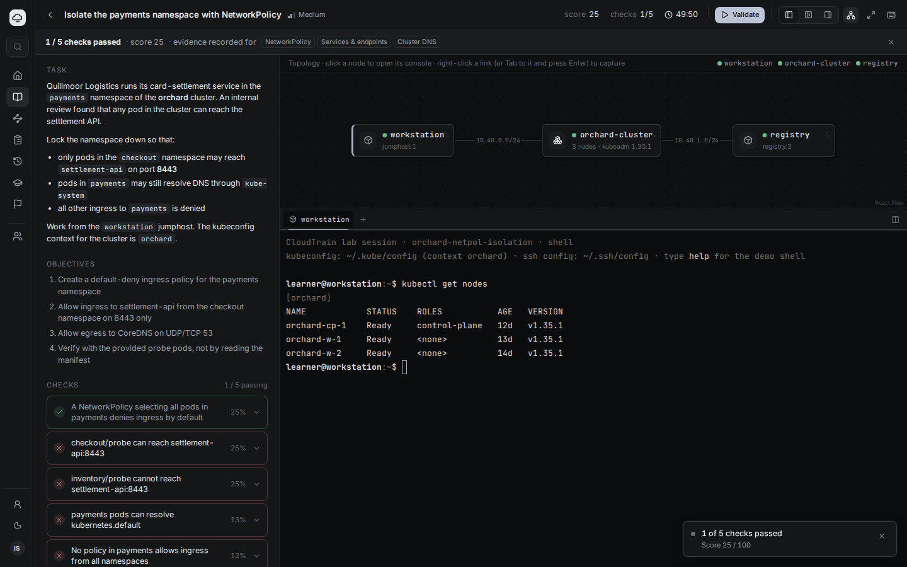

CloudTrain gives every learner their own real environment: kubeadm clusters on
VMs, virtual clusters, Linux hosts, routers and switches, wired together on a
private network. The learner works in a browser terminal, and the platform grades
the end state with typed checks, so there are no multiple-choice shortcuts. Each
result is evidence for specific skills, and an adaptive model picks the next lab.
When a learner is ready, they take a timed exam simulation built the same way.

## Highlights

- **Real environments, not simulators.** A lab is a topology: jumphost
  containers, KubeVirt VMs, kubeadm clusters booted from golden images, vclusters
  and FRR routers. Each lab gets its own Kube-OVN network, and every link is its
  own segment, with packet capture and latency/loss impairment.
- **Graded on what's actually there.** Checks are typed (Kubernetes queries,
  `auth can-i`, shell, files, service state, reachability, device commands) and
  run with admin credentials the learner never sees. Hints cost points, and
  learner-facing messages never reveal the answer.
- **Labs that are proven to work.** Every lab ships with a reference solution,
  alternative valid solutions, and wrong-approach "misconceptions". `labctl verify`
  runs each one live: checks must fail before the solution and pass after it,
  every misconception must fail the checks aimed at it, alternatives must pass,
  two random seeds must agree, and teardown must leave nothing behind.
- **Exam simulations.** One timer for the whole exam, no hints, tasks drawn from
  pools weighted like the real blueprint (a retake gets fresh tasks), one shared
  environment, and grading after a freeze, a re-run check and an optional
  reboot. The result is a per-objective score report, with pass/fail against the
  exam's pass mark.
- **Adaptive learning.** A skill graph spanning Kubernetes, Linux, containers,
  infrastructure as code, automation and networking, mapped to CKA, CKAD, CKS,
  LFCS, RHCSA-, Linux+-, Terraform-, RHCE- and CCNA-aligned objectives.
  Recommendations explain why each lab is next.
- **Built for organisations.** Enterprise SSO (Microsoft Entra ID, Okta, Google,
  any OIDC/SAML IdP brokered through Keycloak), roles from IdP app roles and
  groups, and per-organisation data isolation enforced by Postgres row-level
  security. There are views for learners, managers, instructors, authors, org
  admins and platform operators, plus an append-only audit log.
- **Fast and economical sessions.** Warm pools hand out a ready lab in under a
  second, and hibernate/resume keeps the learner's work while freeing compute.
  Instructors can observe a learner's terminal read-only (the learner sees a
  banner) and extend, reset or end sessions.

## A tour

| | |
|---|---|
| 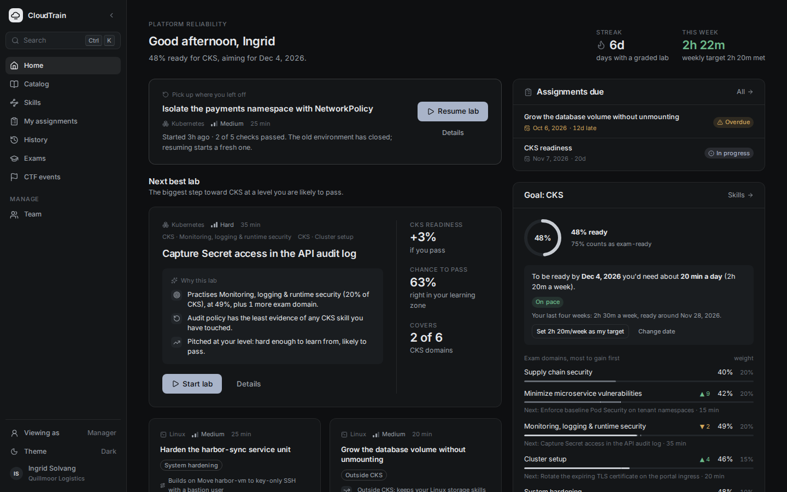 **Home**: the next best lab and why, goal forecast, mastery | 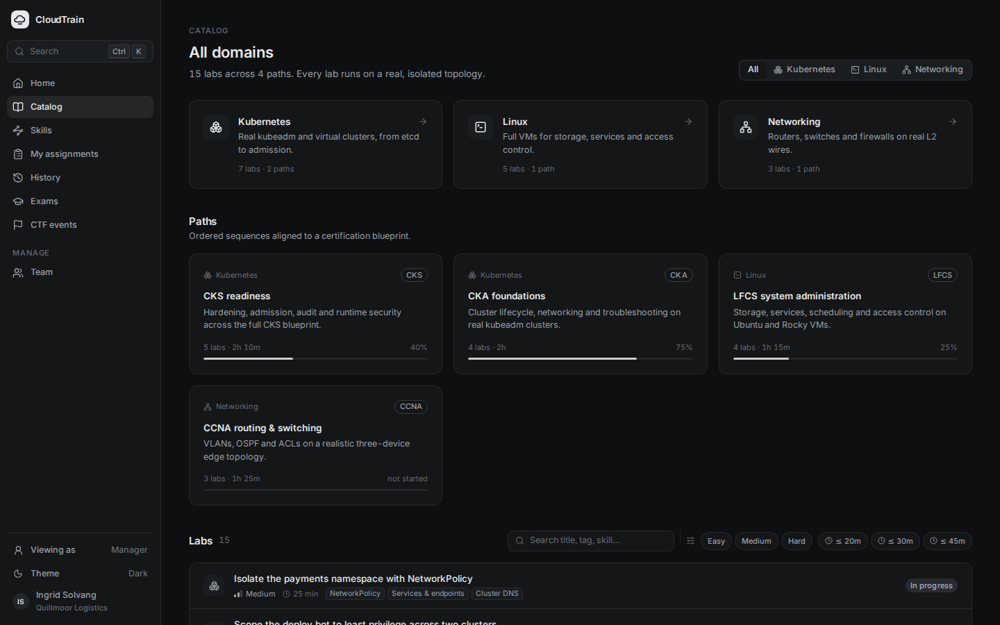 **Catalog**: domains, paths and labs |
| 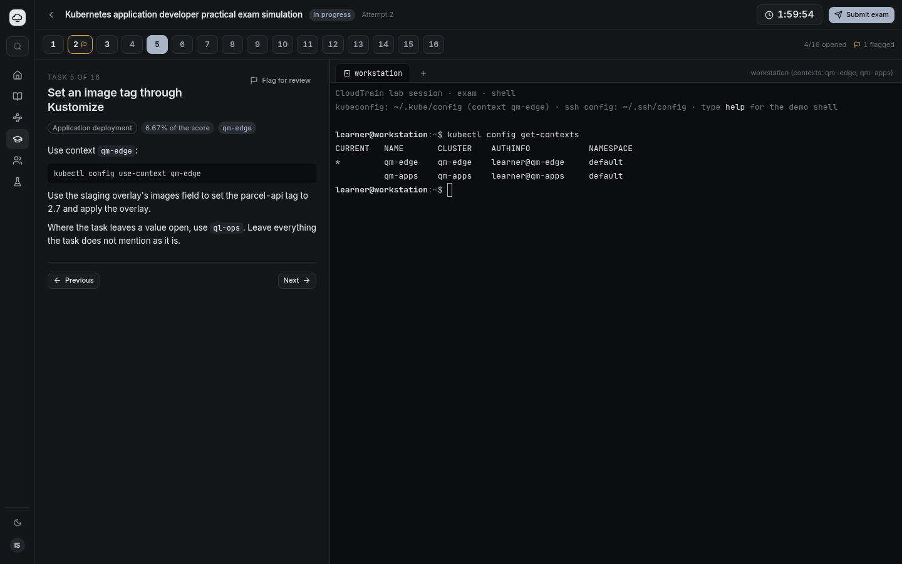 **Exam simulation**: one timer, task navigator with flags, terminals into the exam environment | 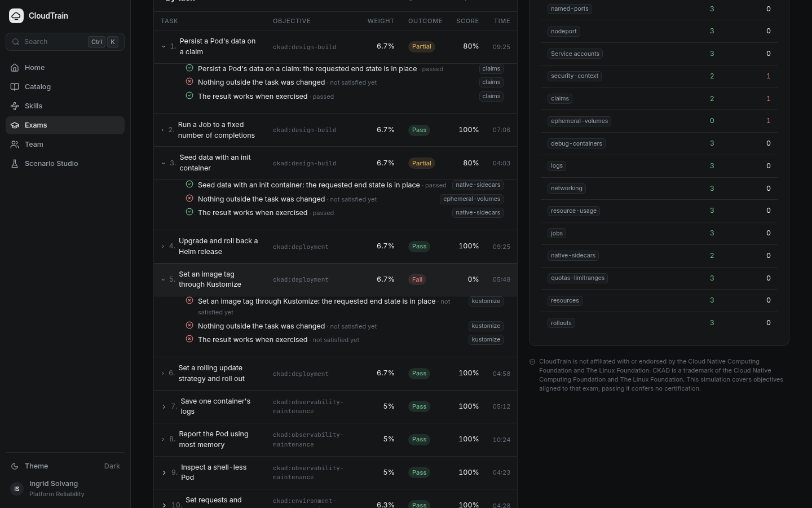 **Exam results**: per-task and per-objective breakdown against the pass mark |
| 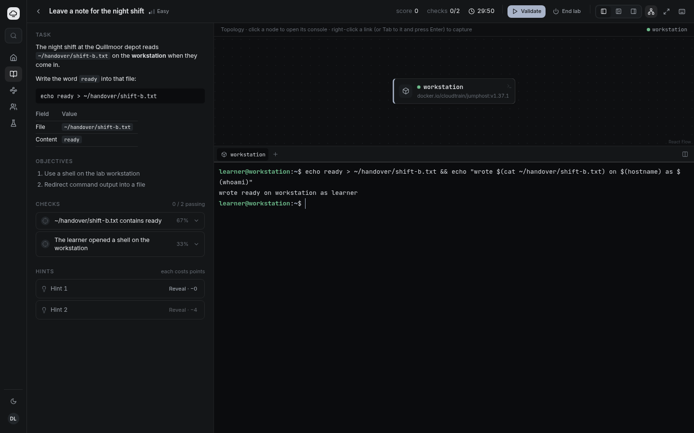 **Real lab**: a terminal into a live lab on the cluster | 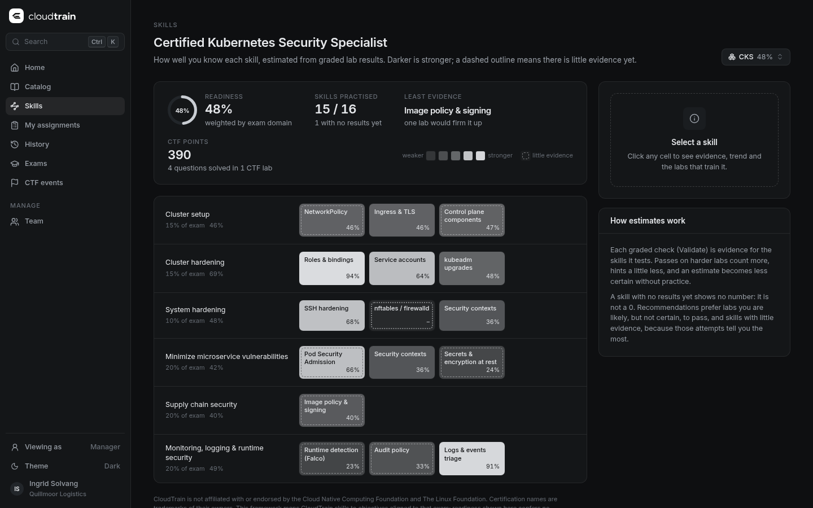 **Skills**: mastery and uncertainty per framework |
| 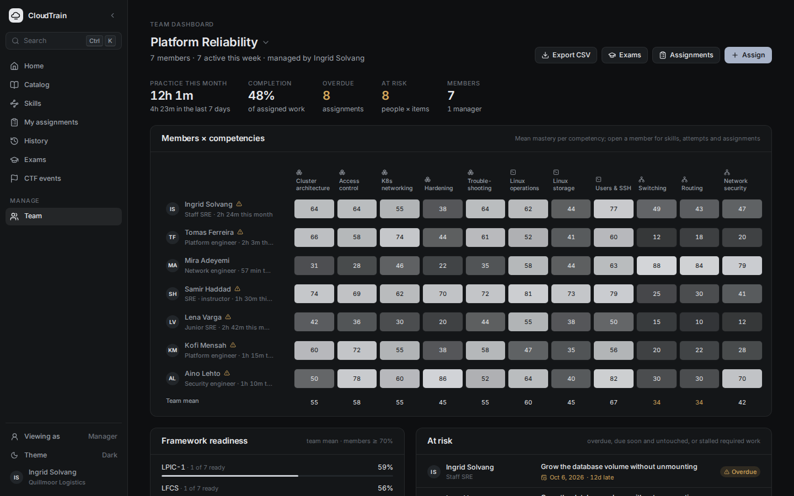 **Manager**: team competency heatmap, deadlines, at-risk learners | 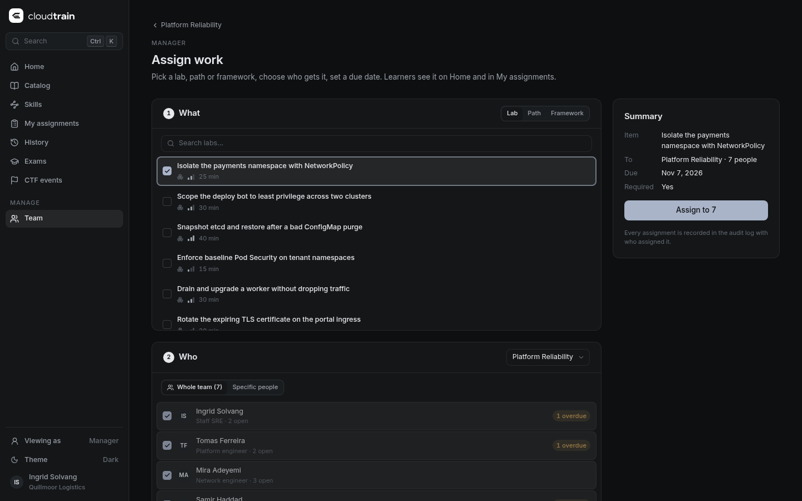 **Assign**: labs, paths or frameworks to people or teams, with due dates |
| 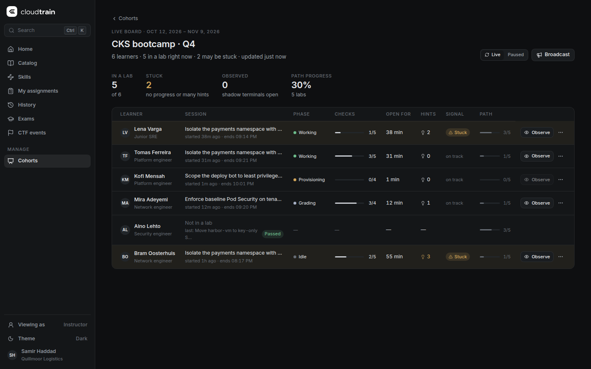 **Instructor**: live cohort board (phase, checks, time on task, "stuck" signal) | 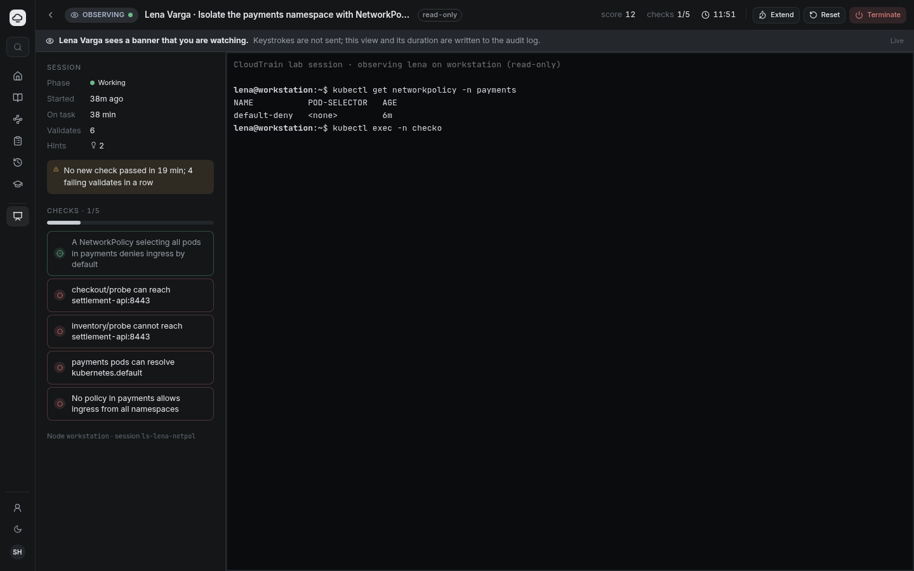 **Observe**: read-only shadow terminal, audited |
| 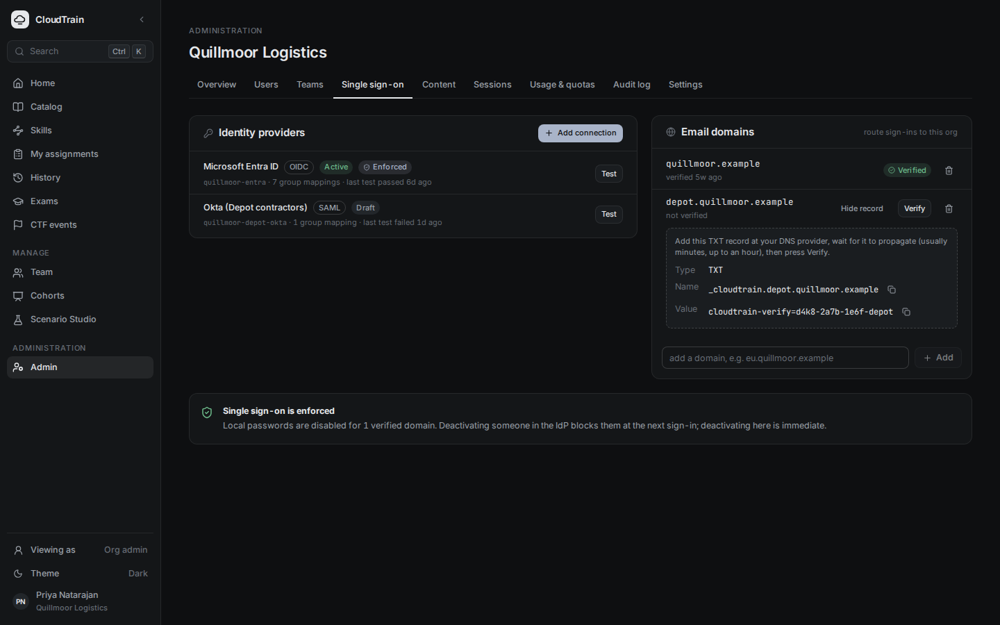 **Org admin**: SSO connections, domain verification, group-to-role mapping | 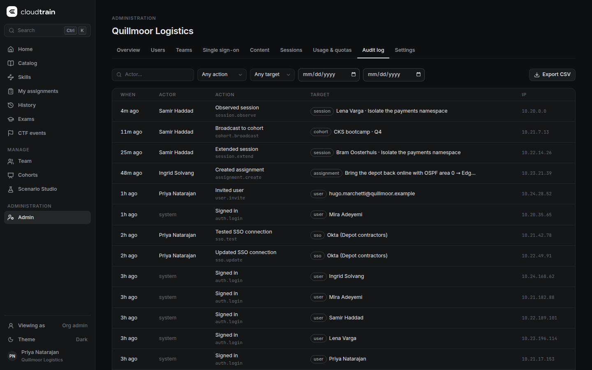 **Audit log**: every administrative action, filterable and exportable |
| 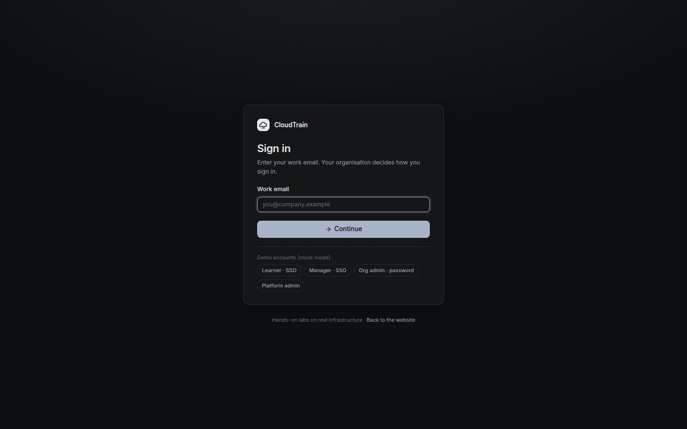 **Sign-in**: identity-first, routes each email domain to its company's IdP | 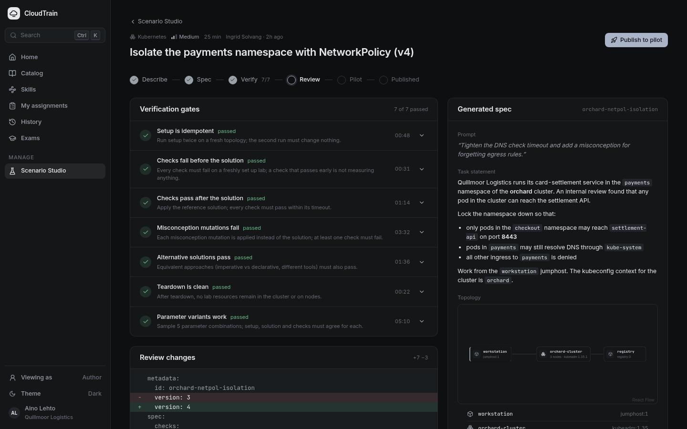 **Scenario Studio**: lab drafts and their verification gates |

Three themes: dark, light and cream ([light](docs/images/workspace-light.png), [cream](docs/images/workspace-cream.png)).

## How it works

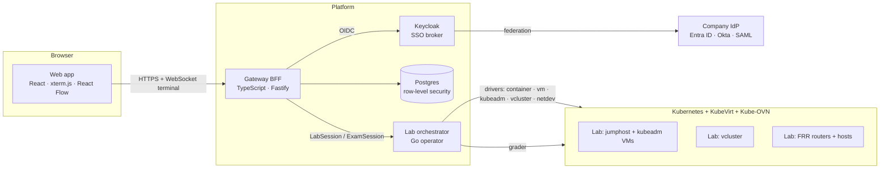

- **Labs are data.** Each lab is a `lab.yaml` (format `cloudtrain.dev/v3`):
  topology, setup, typed checks tagged with skills, hints, misconceptions and
  solutions. `labctl` compiles it into a `LabTemplate`.
- **The orchestrator is a Kubernetes operator** with `LabTemplate`, `LabSession`,
  `WarmPool`, `ExamTemplate` and `ExamSession` resources. Pluggable node drivers
  run containers, KubeVirt VMs, kubeadm clusters, vclusters and network devices.
- **Credentials stay separate.** The learner works as an unprivileged user in the
  entry node; admin credentials live in a sidecar the learner can't read.

## Curriculum

The approved curriculum lives in [`content/curriculum.yaml`](content/curriculum.yaml),
rendered in [`docs/curriculum.md`](docs/curriculum.md). Scenarios are original,
with fictional organisations. Paths and exams are *aligned to* certification
objectives and never copy exam content.

| Domain | Paths | Learning labs + exam tasks | Exam simulations | Built | Verified live |
|---|---|---|---|---|---|
| Kubernetes (administration, development, security) | 5 | 192 | 3 | 173 | 17 |
| Linux administration | 11 | 278 | 3 | 21 | 1 |
| Containers with Docker | 11 | 135 | 2 | — | — |
| Infrastructure as code with Terraform | 5 | 99 | 2 | — | — |
| Configuration management with Ansible | 7 | 97 | 1 | — | — |
| Network administration | 4 | 77 | 1 | — | 2 |
| **Total** | **43** | **878** (499 learning, 379 exam tasks) | **13** | **194** | **20** |

"Built" means written and passing schema, skill and compile validation;
"verified" means it also passed the full live `labctl verify` cycle.

## Status

CloudTrain is in early development. Here is exactly where it stands.

**Working and proven live**
- Local platform: kind with KubeVirt, CDI, Kube-OVN and Multus, one-command setup
  (`task dev:up`), and per-lab network isolation proven by connection checks.
- Lab runtime: container, vcluster, kubeadm-on-VMs and FRR network-device nodes;
  the grader; `labctl verify`; warm pools and hibernate/resume (vcluster).
- Exam engine: drawing tasks, the shared environment, timer freeze, auto-solved
  runs scoring 100%, unsolved runs failing, and retakes drawing different tasks.
- Platform: SSO with real Microsoft Entra ID and brokered IdPs, roles, Postgres
  row-level security, audit logging, assignments, quotas, instructor controls (a
  54-check end-to-end proof).
- Web: learner, exam, manager, instructor, admin and platform views in mock mode;
  real mode drives live labs with a real terminal and real grading.
- 20 labs verified live, and 194 more built.

**Built but not yet proven end to end**
- Hibernate/resume on kubeadm clusters, and VM labs with extra disks.
- Exam simulations through the web app with real sign-in (the engine and API are
  proven separately).
- The full lab-cluster image (metrics-server, ingress, Gateway API, MetalLB,
  storage provisioner, Falco, gVisor, kube-bench).

**Known gaps being worked on**
- Virtual-cluster labs aren't yet hardened for untrusted learners, and must not
  be exposed outside a trusted team until host-side pod security is enforced.
- kubeadm lab clusters need a retry on cluster setup and a configurable
  provisioning timeout to come up reliably on loaded hosts.
- Lab network segments don't yet forward bridged and VLAN-tagged traffic, which
  blocks the switching labs.
- Pod-based Linux labs don't yet allow privilege escalation, which blocks the
  sudo and cron labs.
- Package and registry mirrors for offline labs are scaffolded, not deployed.

**Not started**
- Lab content for containers, Terraform and Ansible, and for Linux labs that
  need VMs or Kata.
- Scenario Studio generation (the UI is mocked) and the AI tutor.
- Production deployment on vCenter with Kata Containers.

## Direction

1. **Harden the runtime:** vcluster pod security, reliable kubeadm bring-up,
   L2/VLAN-capable lab links, a sudo-capable learner mode, offline mirrors.
2. **Finish the Kubernetes track:** verify all 192 labs and run the three
   Kubernetes exam simulations end to end through the web app.
3. **Fill the other domains:** Linux (pods, Kata and VMs), Docker (Kata pods
   running dockerd), Terraform (offline providers against vclusters and
   emulators), Ansible (managed-node VMs), and networking (FRR, SR Linux).
4. **Scenario Studio:** authors describe a lab, it is generated, then gated by
   the same live verifier before a pilot cohort sees it.
5. **AI tutor:** explains failures from check results and terminal context,
   subject to an explicit data policy.
6. **Production:** self-hosted on vCenter (KubeVirt with nested virtualisation,
   Kata for privileged labs), warm pools sized by demand, and multi-tenant SaaS.

## Quick start

UI only, with mock data (no cluster needed):

```bash
pnpm install
task dev:web:mock        # http://localhost:5173 (persona switcher: learner, manager, instructor, admin)
```

Full local stack (Linux or WSL2 with `/dev/kvm`, Docker, ~16 GB RAM free):

```bash
task tools               # pinned CLIs into ~/.local/bin
task dev:up              # kind + KubeVirt + CDI + Kube-OVN + Multus (heals expired certs)
task dev:deps            # Postgres, Keycloak (realms, orgs, IdPs), Mailpit; migrate + seed
task dev:orchestrator    # lab orchestrator in the cluster
task dev:gateway         # gateway on :8787
task dev:web             # web app in real mode on :5173
```

Prove a lab works:

```bash
task lab:verify -- --only scale-berth-planner ../../content/packs/kubernetes/labs
```

Checks:

```bash
pnpm -r build && pnpm -r test
node tools/lab-verify/bin/lab-verify.mjs --strict
cd services/lab-orchestrator && go vet ./... && go test ./...
```

## Repository

| Path | What |
|---|---|
| `apps/web` | Web app (React, TanStack Router, xterm.js, React Flow); mock and real mode |
| `services/gateway` | Backend for the web app: OIDC sessions, authorisation, Postgres, catalog, labs, exams, terminal WebSocket |
| `services/lab-orchestrator` | Kubernetes operator (Go), node drivers, grader, exam engine, `labctl` |
| `packages/lab-schema`, `packages/api-types` | Lab and curriculum schemas; shared API types |
| `content/` | Skill graph, framework mappings, curriculum, lab packs |
| `tools/` | `lab-verify`, curriculum renderer, image builds, license inventory, slot limiter |
| `deploy/` | Local stack: kind, KubeVirt, Kube-OVN, Multus, vcluster, compose deps |
| `docs/` | [Architecture](docs/architecture.md), [platform identity](docs/platform-identity.md), [dev environment](docs/dev-environment.md), [curriculum](docs/curriculum.md), [handoff](docs/handoff.md), [research](docs/research/reports/) |

## Security

Report vulnerabilities privately through GitHub Security Advisories (see
[SECURITY.md](SECURITY.md) once published). Never open a public issue for a
vulnerability.

## License

CloudTrain is **source-available**, not open source.

- **Software:** [Business Source License 1.1](LICENSE). You may use, modify and
  run it for any non-production purpose. Production use is free **only for
  training your own organisation's personnel**. Offering CloudTrain-based
  training, labs or assessments to third parties (hosted, managed, embedded, or
  as a commercial training service) needs a commercial license from AzarGuard.
  Each version becomes Apache-2.0 four years after its first public release.
- **Lab content** (`content/`: labs, skill graph, framework mappings):
  [CC BY-NC 4.0](content/LICENSE). Share and adapt it with credit to
  "CloudTrain by AzarGuard", for non-commercial purposes only.
- **Third-party software:** see [THIRD_PARTY_LICENSES.md](THIRD_PARTY_LICENSES.md) and [NOTICE](NOTICE).
- **Contributing:** see [CONTRIBUTING.md](CONTRIBUTING.md); contributors sign the [CLA](CLA.md).

Certification names are trademarks of their owners. CloudTrain is not
affiliated with or endorsed by any certification body. Screenshots come from
`node apps/web/scripts/readme-shots.mjs`.
