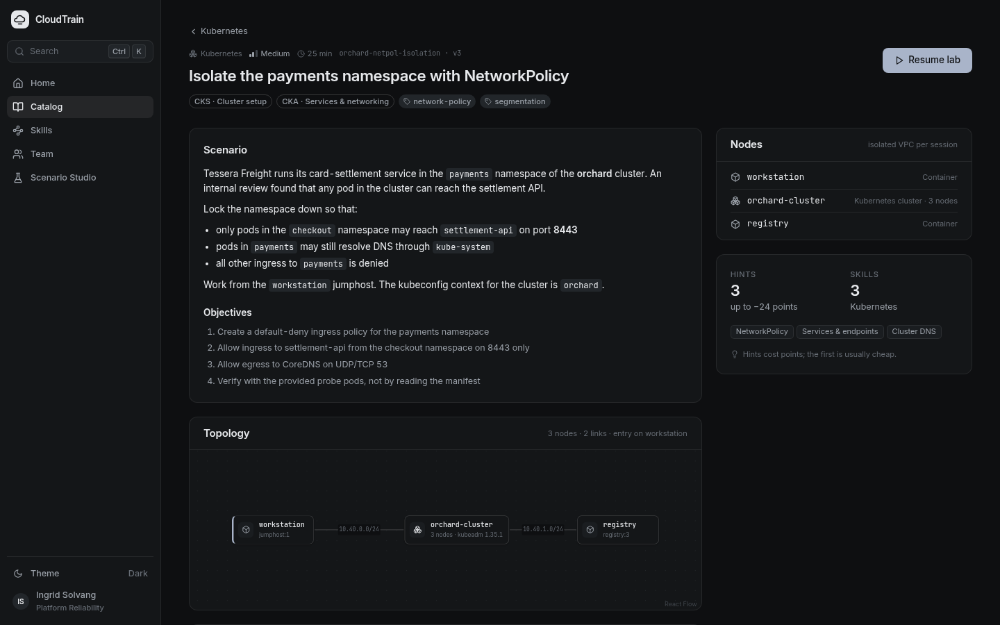
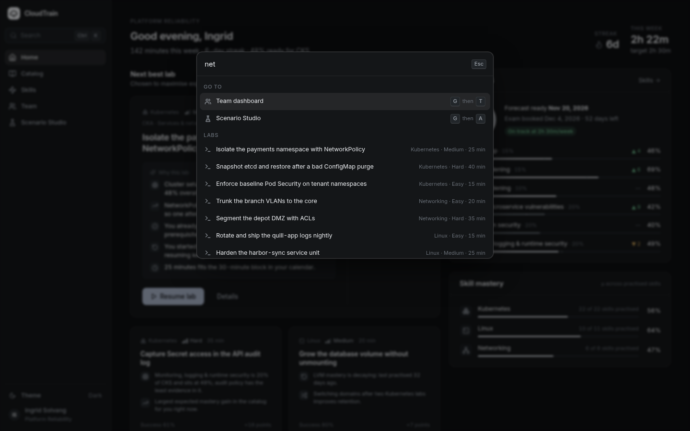
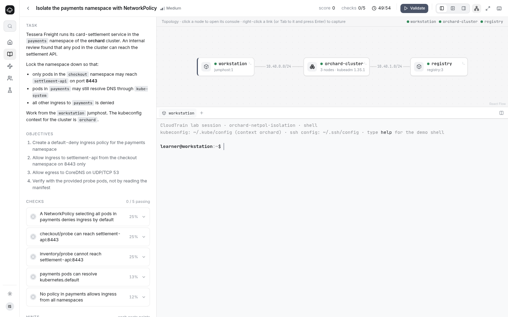
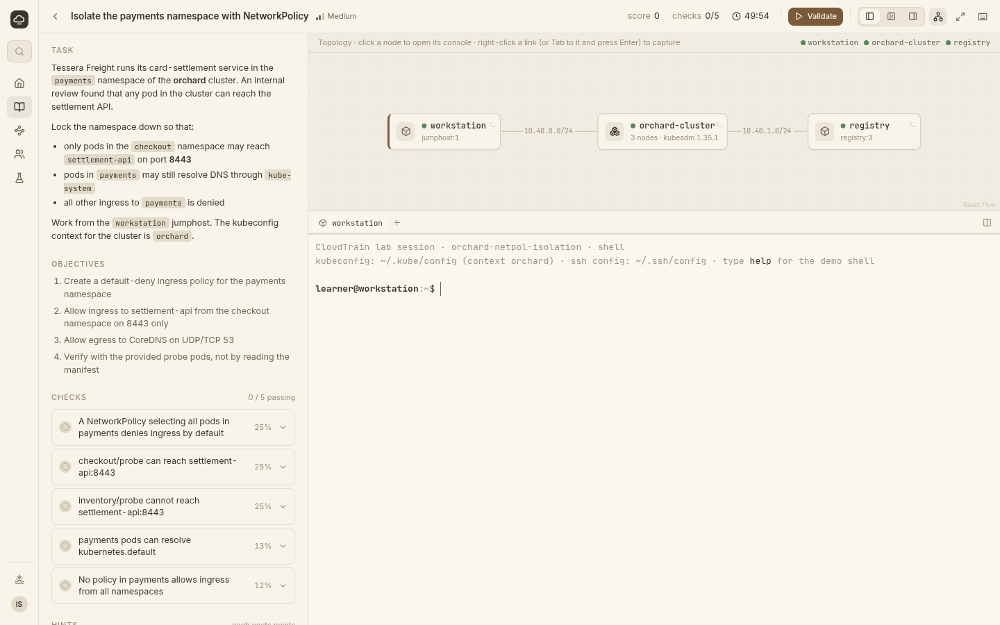

# CloudTrain

Hands-on lab training platform. Learners work in real, isolated environments (Kubernetes clusters, Linux hosts, routed networks), every task is graded automatically, and an adaptive engine picks the next lab from what each learner can already do.


## What it does

- **Real environments, not simulators.** A lab is a topology of nodes and links: jumphost containers, KubeVirt VMs, kubeadm clusters booted from golden images, virtual clusters (vcluster) and network devices (FRR), wired together on per-lab Kube-OVN networks with capture and impairment.
- **Automatic, skill-tagged grading.** Every check is typed (Kubernetes query, `can-i`, shell, file, reachability, device command) and tagged with the skills it gives evidence for.
- **Adaptive learning.** A skill graph (Kubernetes, Linux, networking) mapped to CKA, CKAD, CKS, LFCS and CCNA objectives; recommendations explain themselves.
- **Scenario Studio.** Authors describe a lab; it is generated and verified in a real environment (setup idempotent, checks fail before and pass after the solution, every misconception mutation is caught, teardown clean) before it reaches learners.

## Screenshots

| | |
|---|---|
|  **Home**: next best lab with the reasons, goal forecast, mastery |  **Catalog**: domains, paths and labs |
|  **Lab overview**: objectives, topology, skills |  **Real lab**: terminal into a live lab pod on the cluster |
|  **Skills**: mastery and uncertainty per framework |  **Scenario Studio**: verification gates and review |
|  **Team**: competency heatmap, deadlines, workshops |  **Command palette** (Ctrl+K) |

Three themes: dark, light and cream.

| Light | Cream |
|---|---|
|  |  |

## Repository layout

| Path | What |
|---|---|
| `apps/web` | Web app (React, TanStack Router, xterm.js, React Flow); mock mode or real mode |
| `services/gateway` | Backend for the web app: catalog from `content/`, lab sessions, terminal WebSocket, grading |
| `services/lab-orchestrator` | Kubernetes operator (Go): `LabTemplate`, `LabSession`, `WarmPool`; node drivers; `labctl` |
| `packages/lab-schema` | Lab format (`cloudtrain.dev/v3`) JSON Schema and TypeScript types |
| `packages/api-types` | Types shared by the web app and the gateway |
| `content/` | Skill graph, framework mappings, lab packs |
| `tools/lab-verify` | Content validator (schema, skill references, image catalog, anonymization denylist) |
| `tools/images` | Golden VM and container images for labs |
| `deploy/` | Local dev stack: kind + KubeVirt + CDI + Kube-OVN + Multus |
| `docs/` | [Architecture](docs/architecture.md), [dev environment](docs/dev-environment.md), [Kubernetes readiness](docs/k8s-readiness.md) |

## Quick start

UI only, with mock data (no cluster needed):

```bash
pnpm install
task dev:web:mock        # http://localhost:5173
```

Full local stack (Linux or WSL2 with `/dev/kvm`, Docker):

```bash
task tools               # pinned CLIs into ~/.local/bin
task dev:up              # kind cluster with KubeVirt, CDI, Kube-OVN, Multus
task lab:demo            # proof: kubeadm VMs + jumphost + vcluster, isolation checks
task dev:orchestrator    # lab-orchestrator against the local cluster
task dev:gateway         # gateway on :8787
task dev:web             # web app in real mode
```

Checks:

```bash
pnpm -r build && pnpm -r test
node tools/lab-verify/bin/lab-verify.mjs --strict
cd services/lab-orchestrator && go test ./... && go run ./cmd/labctl validate ../../content/packs/kubernetes/labs
```

## Status

Early development. Working today: the web app (mock and real mode), the gateway, the lab compiler and operator, container and network-device (FRR) nodes with per-link networks, and the local KubeVirt stack. In progress: kubeadm/vcluster/VM node drivers, the grader and the lab verifier, so that every lab in the Kubernetes pack runs end to end.

All lab content is original: fictional organisations, node names and resources.

Screenshots are regenerated with `node apps/web/scripts/readme-shots.mjs` against the mock-mode dev server.
