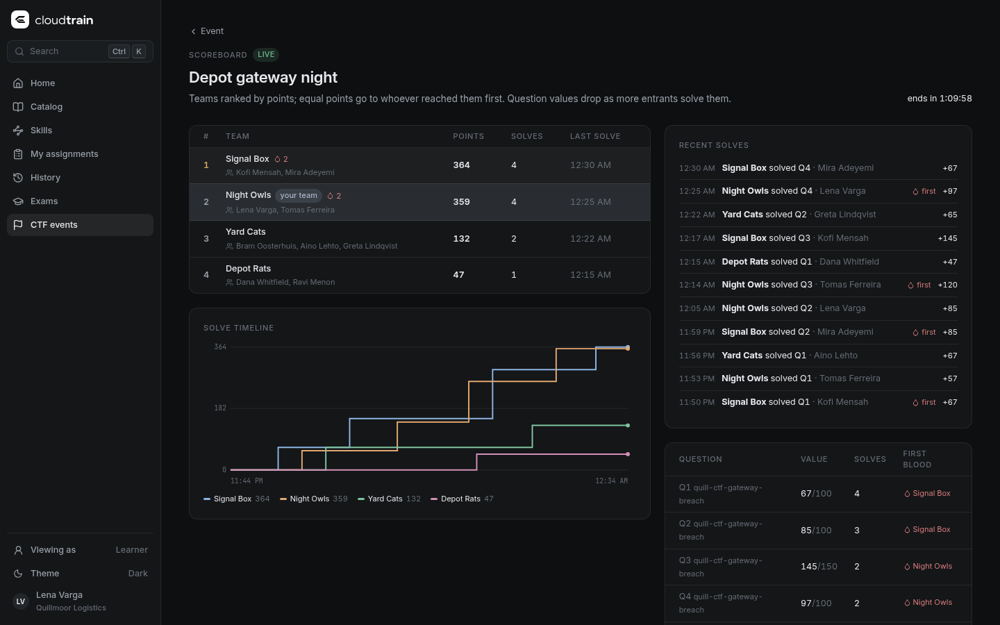

# Running a CTF event

A **CTF event** is a timed competition over one or more CTF labs (labs with
answer checks, see `docs/ctf-authoring.md`). Learners play solo or in teams;
a live scoreboard ranks them. Solo CTF labs stay in the catalog and keep
working outside events.

## Who can do what

| Action | Permission |
|---|---|
| See published events, join, play, see the scoreboard | `lab.run` |
| Create, edit, publish and delete events; manage teams; see the scoreboard live during a freeze; the manager view and the CSV export | `event.manage` (manager, instructor and org admin, org-wide) |

Every management action and every export is written to the audit log
(`event.create`, `event.update`, `event.delete`, `event.join`, `event.leave`,
`event.team_create`, `event.team_members`, `event.team_delete`,
`event.export`); answers and hints are audited as `answer.submit` and
`answer.hint` with the event and team in the details.

## Create an event

**CTF events → New event** (`/events`):

- **Labs**: any CTF labs the organisation can see. The challenges are their questions.
- **Window**: start and end. Learners can join before the start; labs open at
  the start, answers close at the end, and every event session ends with the
  event at the latest (the LabSession's `expiresAt`).
- **Participation**: solo, or teams with a largest team size. Teams are formed
  by the learners (they create a team or join one with room left) or by you
  (learners join, you put them in teams on the manage page).
- **Scoring**:
  - *static*: a question is worth its points;
  - *dynamic*: its value drops as more entrants solve it, following CTFd's curve
    `value = points + (min - points) / decay² × (solves - 1)²`, never below
    `min = minimum % × points`. It is retroactive: every solver gets the current
    value, so solving early is never worse.
  - Either way each entrant's award is the value minus that entrant's wrong-answer
    penalties and hint costs (`docs/ctf-authoring.md`).
- **First-blood markers**: mark the first solve of every question (scoreboard,
  solve feed and the solver's questions panel).
- **Freeze**: learners see the scoreboard as it was N minutes before the end;
  managers always see it live. It unfreezes when the event ends.
- **Published**: learners only see published events. Publish when the labs and
  window are right; you can edit until then (the mode cannot change after the start).

## During the event

- **Learners** open the event, join (solo) or create/join a team, and press
  **Start** on a challenge. The lab view's Questions panel shows the event, the
  team and the end time.
- **Teams share progress.** Each team member gets their own lab environment, but
  every member of a team gets the same seed (per event, team and lab), so the
  data and the expected answers are identical. Submissions and hints count for the
  team: a question one member solves is solved for all ("Solved by …"), wrong
  answers and attempts are counted per team, and a hint one member reveals is
  revealed (and paid) for the team.
- Different teams (or players in a solo event) get different seeds, so answers
  cannot be passed between them.
- The **scoreboard** (`/events/:id/scoreboard`) refreshes every 10 s: rank,
  points, solves, first bloods and last solve (equal points: the earlier last
  solve ranks higher), the cumulative points timeline of the top six, recent
  solves, and each question's current value and solve count.

## Manage view and results

`/events/:id/manage`: publish or unpublish, edit, delete, the live scoreboard,
teams (add a team, set members from the participants), and every participant
with their team, answers, correct answers, hints and last activity.

**Export results** downloads a CSV: rank, team or participant, members (emails),
points, solves, first bloods, last solve, and one column per question with the
solve time and its points. Cells are escaped against spreadsheet formula
injection.

## How it fits the platform

- Event sessions are ordinary lab sessions with two labels,
  `cloudtrain.dev/ctf-event` and `cloudtrain.dev/ctf-team`, a fixed seed and an
  `expiresAt` capped at the event end, much like exam environments end at the
  exam deadline. The web countdowns use the exam engine's server-anchored clock.
- Answers go through the same answer service as solo labs; the event decides the
  scope (team or player), refuses answers outside the window and provides the
  dynamic values and first bloods. Personal points still land in History and
  Skills.
- Data: `ctf_events`, `ctf_event_teams` and `ctf_event_participants` (migration
  `0006_ctf_events`) under row-level security; submissions and hints are the
  `answer_submissions` / `answer_hint_reveals` rows with `event_id` and `team_id`.
  Scoring is computed from them on request (`services/gateway/src/events/scoring.ts`).

## API

| Method + path | Permission |
|---|---|
| `GET /api/events` | `lab.run` (drafts need `event.manage`) |
| `POST /api/events` (`CreateCtfEventRequest`) | `event.manage` |
| `GET /api/events/:id` | `lab.run` |
| `PATCH /api/events/:id`, `DELETE /api/events/:id` | `event.manage` |
| `POST /api/events/:id/join` (`{ teamId }` or `{ teamName }` in self-formed team events), `POST /api/events/:id/leave` (before the start) | `lab.run` |
| `POST /api/events/:id/teams`, `PUT /api/events/:id/teams/:teamId/members`, `DELETE /api/events/:id/teams/:teamId` | `event.manage` |
| `POST /api/events/:id/labs/:labId/sessions` (start or resume) | `lab.run` (joined, in a team for team events, while running) |
| `GET /api/events/:id/scoreboard` | `lab.run` (frozen for learners) |
| `GET /api/events/:id/report`, `GET /api/events/:id/results.csv` | `event.manage` |

Shapes: `packages/api-types/ctf.d.ts`.
